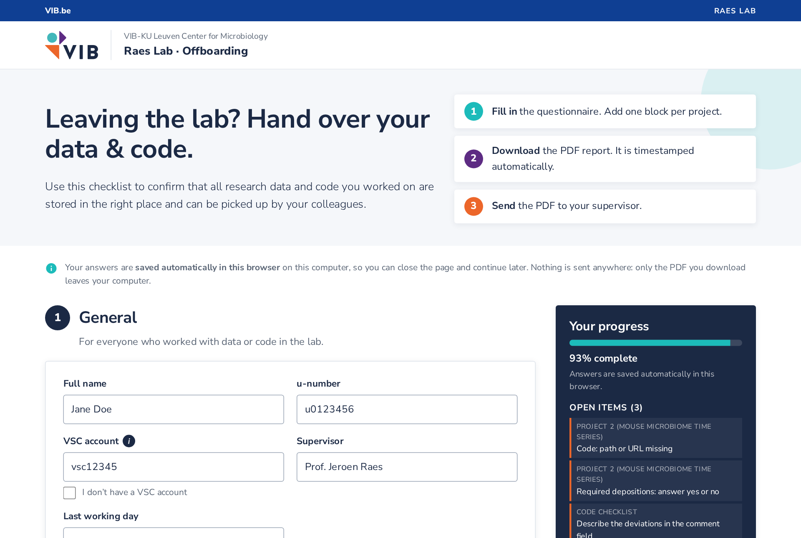
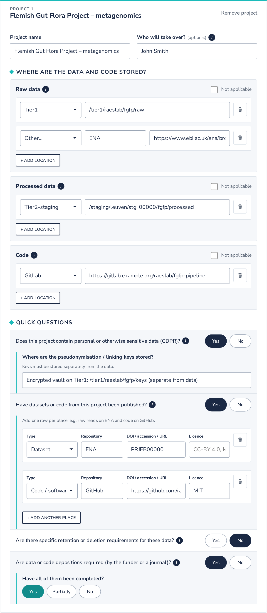
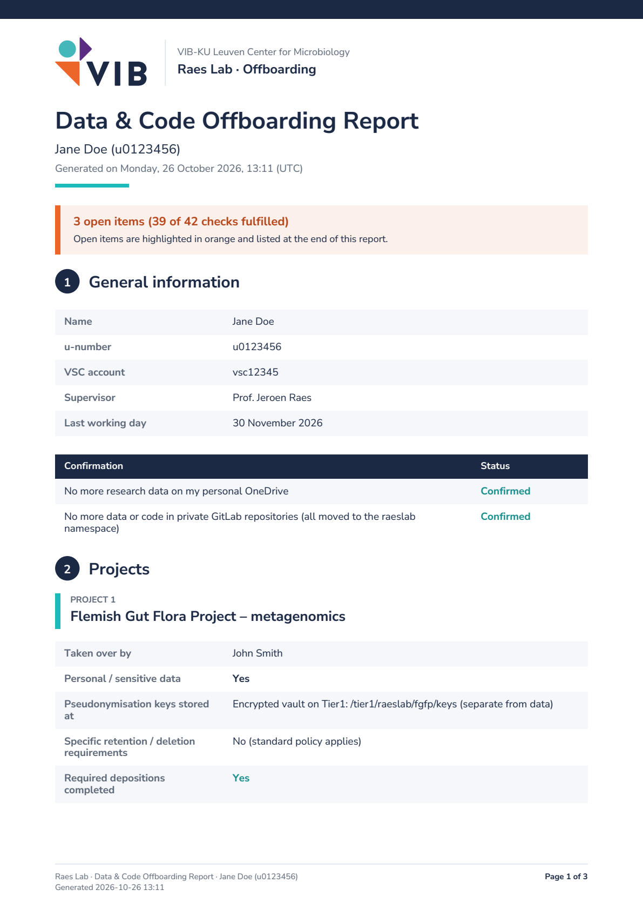
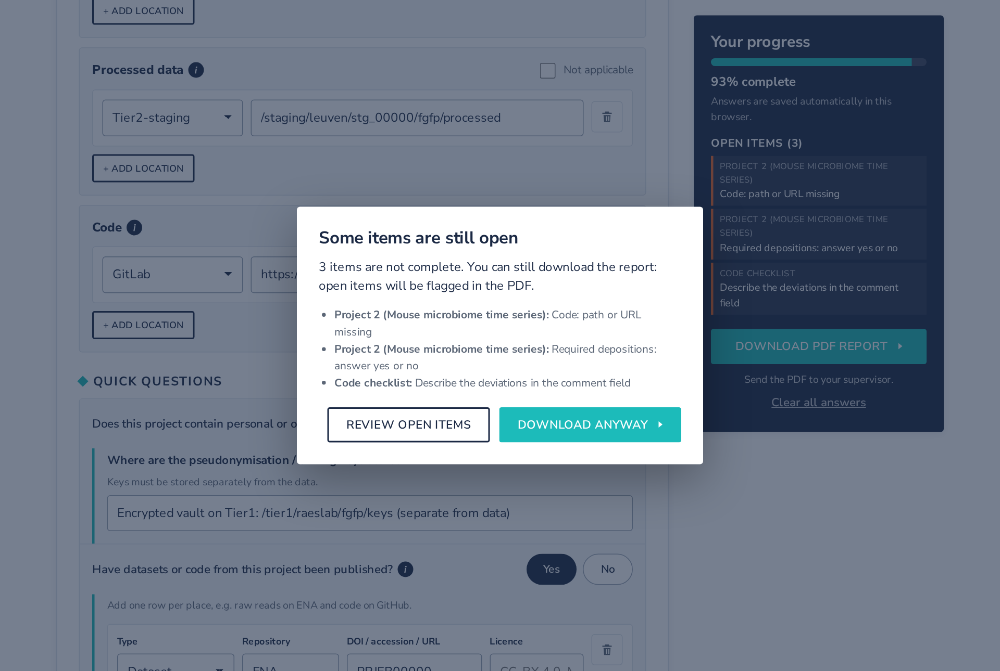
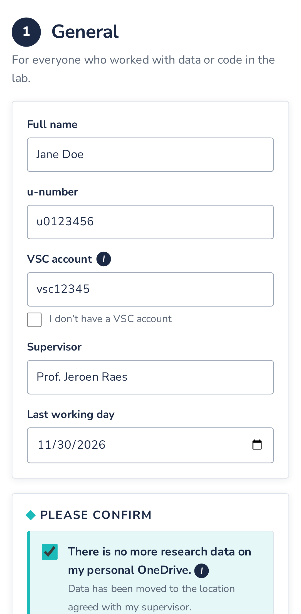

# Data & code offboarding checklist (Raes Lab, VIB)

**Live site:** <https://raeslab.github.io/offboarding/> · **Repository:** <https://github.com/raeslab/offboarding>

A static website where lab members who leave can confirm that all of their research **data and code** has been handed over properly. They fill in the questionnaire, download a timestamped **PDF report**, and send it to their supervisor. The site is part of the lab's off-boarding procedure.

- **No backend.** The site is plain HTML/CSS/JavaScript in `docs/`, hosted on GitHub Pages.
- **Resume later.** Answers are saved automatically in the browser's `localStorage`, so people can close the tab and continue later on the same computer and browser.
- **Private.** Nothing is sent anywhere. Only the PDF that the user downloads leaves their computer.
- **VIB look & feel.** It uses VIB colours, the VIB logo and VIB's body font *Nunito Sans*. All of these are vendored, so there are no CDNs at runtime.

## Screenshots

The questionnaire. The sidebar shows your progress and the items that are still open.



<table>
  <tr>
    <td width="60%"></td>
    <td width="40%"></td>
  </tr>
  <tr>
    <td>One block per project: where the data and code are stored, plus quick yes/no questions that open extra fields when needed.</td>
    <td>The timestamped PDF report that is sent to the supervisor.</td>
  </tr>
</table>

If items are still open when you export, the site lists them first. You can still download the PDF.





The form also works on a phone.

All screenshots use made-up demo data. To regenerate them, run `npm run screenshots` and then `uv run python scripts/render_pdf.py docs/img/report.pdf --scale 2`. Keep only `report-p1.png`.

## What is asked

1. **General**
   - Name, u-number, VSC account (or "I don't have one"), supervisor and last working day.
   - Explicit confirmation that no research data is left on the person's **personal OneDrive**.
   - Explicit confirmation that no data or code is left in **private GitLab repositories**. Projects must be moved to the `raeslab` namespace by a maintainer.
2. **Projects** (repeatable). For each project:
   - Name, and who takes over (if known).
   - Locations of **raw data**, **processed data** and **code**. Location types are Tier1, Tier2-staging, GitLab or Other (Other must be specified). Each location needs a path or URL. A category can have several locations, or be marked "Not applicable".
   - Four quick **Yes/No** questions. The detailed fields only appear for "Yes", which keeps the form fast:
     - Sensitive / personal data (GDPR)? → where the pseudonymisation keys are stored.
     - Anything published? → type, repository, DOI/accession, licence (one row per output).
     - Specific retention or deletion requirements? → retention period and deletion requirements.
     - Depositions required? → whether they are all done (Yes/Partially/No), and a comment if not.
3. **Code checklist** (covers all repositories)
   - Each repository has a README.md.
   - Software versions are pinned (renv / venv / conda / containers).
   - Example data is included.
   - Each item is answered Yes / Partially / No / N/A. Any answer other than "Yes" needs an explanation in the comments field.

Validation is **soft**. Missing or odd answers (e.g. a u-number that does not match `u` + 7 digits) appear as open items in the sidebar and inline. The PDF can still be exported, but open items are highlighted in orange and listed at the end of the report.

The PDF file is named `Offboarding_<Name>_<u-number>_<YYYY-MM-DD>.pdf`. It contains the date and time of generation on the first page and in the footer of every page.

## Repository layout

```
docs/                     ← the website (GitHub Pages root)
  index.html
  css/style.css
  js/config.js            ← all texts, options, tooltips, patterns (edit here)
  js/model.js             ← data model + validation (no DOM; unit-testable)
  js/pdf.js               ← PDF report (jsPDF + autotable)
  js/logo.js              ← VIB logo as vector paths for the PDF
  js/app.js               ← UI, autosave, export
  assets/                 ← VIB logos + favicons (from vib.be)
  img/                    ← README screenshots (tests/make_screenshots.js)
  vendor/jspdf/           ← jsPDF + jspdf-autotable (MIT)
  vendor/fonts/           ← Nunito Sans TTFs (SIL OFL)
scripts/fetch_vendor.py   ← (re)downloads everything in docs/vendor and docs/assets
tests/                    ← Playwright end-to-end tests + tiny static server
```

## Development environment (VS Code dev container)

The repository includes a dev container with these tools:

- Debian 13
- uv with Python 3.14
- Node 24
- Playwright with Chromium
- Claude Code

Requirements: Docker Desktop and VS Code with the **Dev Containers** extension (`ms-vscode-remote.remote-containers`).

To set it up:

1. Open the folder in VS Code.
2. Run **Dev Containers: Reopen in Container** from the Command Palette (`Ctrl+Shift+P`).
3. Wait for the first build. It takes a few minutes. Afterwards, `uv sync` and `npm install` run automatically.

| Task | Command |
|---|---|
| (Re)vendor third-party files | `uv run python scripts/fetch_vendor.py` |
| Serve the site on :4173 (forwarded to the host) | `npm run serve` |
| End-to-end tests | `npm test` |
| Sample PDFs without a browser | `npm run pdf:samples` |
| README screenshots → `docs/img/` | `npm run screenshots` |
| Render PDFs to PNG for review | `uv run python scripts/render_pdf.py test-results/samples/*.pdf` |
| Lint Python | `uv run ruff check scripts` |

Commit `uv.lock` and `package-lock.json` after the first `uv sync` / `npm install`.

## Run locally

Any static file server will do:

```bash
node tests/serve.js            # http://localhost:4173
# or
python -m http.server 4173 -d docs
```

Opening `docs/index.html` directly from disk (`file://`) also works. In that case the browser blocks loading the font files for the PDF, so the PDF falls back to Helvetica. Over http(s), Nunito Sans is embedded.

## Deploy on GitHub Pages

1. Push the repository to GitHub.
2. Go to **Settings → Pages → Build and deployment**. Choose *Deploy from a branch*, then pick branch `main` and folder **`/docs`**.
3. The site appears at <https://raeslab.github.io/offboarding/>. `docs/.nojekyll` disables Jekyll processing.

The repository is **public**. Do not commit real paths, storage project numbers, names or exported reports (`*.pdf` is ignored by `.gitignore`).

## Configuration

All wording lives in [`docs/js/config.js`](docs/js/config.js):

- group and organisation names, and who the report is sent to
- the GitLab namespace and an optional URL for it (`gitlab.namespaceUrl`, shown as a link when set)
- location types and their placeholders
- tooltips and the code checklist items
- the u-number and VSC format patterns
- the `localStorage` key. Change its suffix (`-v1` → `-v2`) only if the data model changes incompatibly.

## Vendored third-party files

| What | Version | Licence | Location |
|---|---|---|---|
| jsPDF | 4.2.1 | MIT | `docs/vendor/jspdf/` |
| jspdf-autotable | 5.0.9 | MIT | `docs/vendor/jspdf/` |
| Nunito Sans (static TTFs) | Google Fonts | SIL OFL 1.1 | `docs/vendor/fonts/` |
| VIB logo, favicons | — | VIB trademark, used for a VIB lab tool | `docs/assets/` |

To refresh or bump versions, edit the constants at the top of `scripts/fetch_vendor.py` and run:

```bash
python scripts/fetch_vendor.py
```

VIB's heading font, *Degular*, is licensed through Adobe Fonts and may not be self-hosted. Headings therefore use Nunito Sans 700.

## Tests

End-to-end tests use [Playwright](https://playwright.dev). They cover:

- the page loads without errors
- answers persist across reloads
- projects and locations can be added and removed
- conditional fields appear when needed
- a complete export downloads a PDF with today's date in its name
- an incomplete export shows a warning and can still be downloaded
- "Clear all answers" resets everything
- tooltips open on tap without toggling the surrounding checkbox, and stay inside the viewport
- keyboard-only use: radio pills, focus after a re-render, closing dialogs with Escape
- no horizontal scrolling
- full-page screenshots (empty form, export dialog, open items) saved to `test-results/screenshots/` for visual review

```bash
npm install
npx playwright install chromium
npm test
```

The tests start `tests/serve.js` automatically. They run on a desktop and a mobile (Pixel 7) viewport. Playwright writes its own output to `test-results/e2e/`, so a test run does not delete the sample PDFs or the screenshots.

To review the PDF layout without a browser:

```bash
npm run pdf:samples                                              # complete / empty / heavy × Nunito / Helvetica
uv run python scripts/render_pdf.py test-results/samples/*.pdf   # → PNG per page
```

## How the code works

- **State** lives in `localStorage['raeslab-offboarding-v1']`. Text input is saved after a 300 ms debounce; checkboxes, radios, selects and add/remove actions are saved immediately. `model.normalize()` makes old or corrupt saved data safe to load, including answers saved before the quick yes/no questions existed.
- **Binding.** Every input has a `data-bind` path such as `general.name` or `projects.0.locations.raw.items.1.path`. Typing updates the state without re-rendering. Checkbox, radio and select changes and add/remove actions re-render the form from string templates in `app.js`, keeping focus and scroll position.
- **Validation** (`model.validate()`) returns `{issues, total, done}`. A field shows its warning once it has been touched, or after the user clicks *Download PDF report* or an open item in the sidebar.
- **Tooltips** are `<button>`s inside the label. A click calls `preventDefault()`, so it does not toggle the checkbox. `app.js` shifts the bubble sideways, or flips it below the icon, to keep it on screen.
- **PDF** (`pdf.js`): `build({state, config, now, jsPDF, fonts})` and `filename(state, now)`. The Nunito Sans TTFs are fetched and embedded. Under `file://` that fetch fails and the PDF falls back to Helvetica; text is then transliterated to Latin-1. The VIB logo is drawn from vector paths (`logo.js`).
- `window.Offboarding.app.getState()` is a hook for the tests.

## Privacy note

Answers are stored only in the user's own browser (`localStorage`, key `raeslab-offboarding-v1`) until they press **Clear all answers**. When using a shared or public computer, clear the answers after downloading the PDF.
